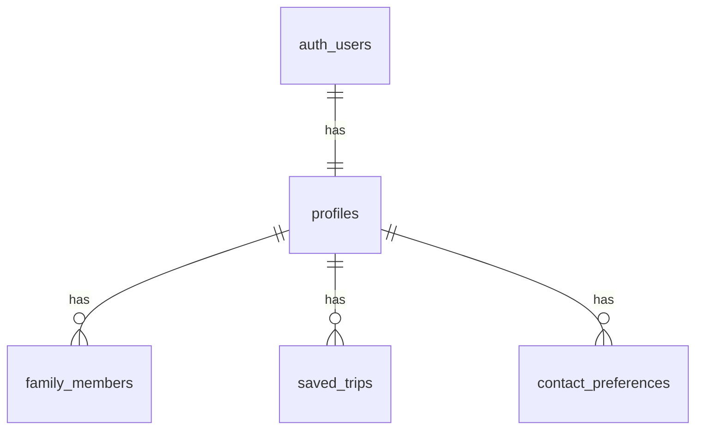

# Data Model: User Settings (005)

All tables are in the `public` schema of the Supabase Postgres database. Every table has row-level security (RLS) turned on, and access comes only from the policies listed in [contracts/rls-policies.md](contracts/rls-policies.md). The full schema is in migration `supabase/migrations/20261024000100_user_settings.sql`.



## profiles

One row per account. It is created by the trigger `on_auth_user_created`, which runs `public.handle_new_user()` (security definer) after each insert into `auth.users`.

| Column          | Type          | Rules                                                                 |
| --------------- | ------------- | --------------------------------------------------------------------- |
| id              | `uuid` PK     | References `auth.users(id)` with `on delete cascade`                  |
| display_name    | `text` null   | `char_length` between 1 and 50, after trimming                        |
| home_place_name | `text` null   | Up to 120 characters                                                  |
| home_lat        | `float8` null | Between -90 and 90. Set together with `home_lng`, or both null       |
| home_lng        | `float8` null | Between -180 and 180                                                  |
| theme           | `text`        | One of `system`, `light`, `dark`. Default `system`                    |
| created_at      | `timestamptz` | Default `now()`                                                       |
| updated_at      | `timestamptz` | Default `now()`. Kept current by the `set_updated_at` trigger         |

## family_members

| Column      | Type            | Rules                                                                                 |
| ----------- | --------------- | ------------------------------------------------------------------------------------- |
| id          | `uuid` PK       | Default `gen_random_uuid()`                                                           |
| profile_id  | `uuid`          | References `profiles(id)` with `on delete cascade`. Indexed                           |
| nickname    | `text`          | `char_length` between 1 and 30, after trimming                                        |
| kind        | `text`          | One of `adult`, `child`, `dog`                                                        |
| birth_year  | `smallint` null | Between 1900 and the current year                                                     |
| birth_month | `smallint` null | Between 1 and 12                                                                      |
| sort_order  | `int`           | Default 0                                                                             |
| created_at  | `timestamptz`   | Default `now()`                                                                       |

A check constraint requires that `kind = 'child'` exactly when both `birth_year` and `birth_month` are set. A trigger limits each profile to 20 members, which matches the URL state's family size limit.

## saved_trips

| Column        | Type          | Rules                                                           |
| ------------- | ------------- | --------------------------------------------------------------- |
| profile_id    | `uuid`        | References `profiles(id)` with `on delete cascade`              |
| activity_id   | `text`        | The ID from `Activity.id`, up to 200 characters                 |
| activity_name | `text`        | Copy of the name at save time, up to 200 characters             |
| saved_at      | `timestamptz` | Default `now()`                                                 |
| planned_for   | `date` null   |                                                                 |
| note          | `text` null   | Up to 500 characters                                            |
| updated_at    | `timestamptz` | Kept current by the `set_updated_at` trigger                    |

The primary key is `(profile_id, activity_id)`, so each activity can be saved once per profile. Merging the session's saved activities on sign-in uses `upsert ... on conflict do nothing`. The list is ordered by `planned_for asc nulls last, saved_at desc`, with index `(profile_id, planned_for, saved_at desc)`.

## contact_preferences

| Column     | Type          | Rules                                                   |
| ---------- | ------------- | ------------------------------------------------------- |
| profile_id | `uuid`        | References `profiles(id)` with `on delete cascade`      |
| topic      | `text`        | One of `product_news`, `nearby_digest`                  |
| opted_in   | `boolean`     | Default `false`                                         |
| frequency  | `text` null   | One of `weekly`, `monthly`. Only for `nearby_digest`    |
| changed_at | `timestamptz` | Default `now()`. Set whenever `opted_in` changes        |

The primary key is `(profile_id, topic)`. A missing row means the user has not opted in.

## Client-side types (`src/account/types.ts`)

```ts
export type ThemePreference = 'system' | 'light' | 'dark';
export type MemberKind = 'adult' | 'child' | 'dog';

export interface Profile {
  id: string;
  displayName: string | null;
  home: { name: string; lat: number; lng: number } | null;
  theme: ThemePreference;
}
export interface FamilyMember {
  id: string;
  nickname: string;
  kind: MemberKind;
  birth: { year: number; month: number } | null; // child only
  sortOrder: number;
}
export interface SavedTrip {
  activityId: string;
  activityName: string;
  savedAt: string;
  plannedFor: string | null; // ISO date
  note: string | null;
}
export type ContactTopic = 'product_news' | 'nearby_digest';
export interface ContactPreference {
  topic: ContactTopic;
  optedIn: boolean;
  frequency: 'weekly' | 'monthly' | null;
  changedAt: string;
}
```

## Deriving default filters (`src/domain/family.ts`)

`familyDefaults(members, today)` returns `Partial<Filters>`:

- **ages**: the `AGE_GROUPS` ids that contain at least one child's age. Groups are ordered and duplicates removed. A child aged 18 or over adds no group.
- **familySize**: the number of members whose kind is not `dog`. This is left unset when that number is 0.
- **dogFriendly**: `true` when at least one member is a `dog`, otherwise left unset.

These defaults apply only when the URL has no filter parameters (FR-008).
