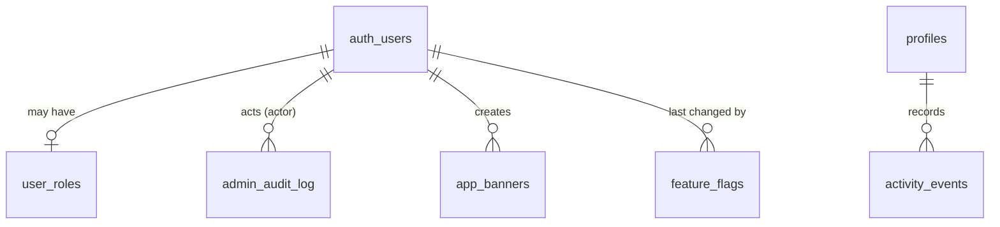

# Data Model: Admin Settings (006)

This extends the [005 data model](../005-user-settings/data-model.md). All tables are in `public`, and all have row-level security (RLS) turned on. The schema is in migration `supabase/migrations/20261101000100_admin_settings.sql`.

## Changes to `profiles` (from 005)

| Column            | Type               | Rules                                             |
| ----------------- | ------------------ | ------------------------------------------------- |
| status            | `text`             | One of `active`, `deactivated`. Default `active`  |
| status_reason     | `text` null        | Up to 500 characters. Required when deactivated   |
| status_changed_by | `uuid` null        | References `auth.users(id)`, set null on delete   |
| status_changed_at | `timestamptz` null |                                                   |
| tracking_opt_out  | `boolean`          | Default `false`. See FR-015                       |

There is also a `pg_trgm` GIN index on `display_name`.

## user_roles

| Column     | Type          | Rules                                                                  |
| ---------- | ------------- | ---------------------------------------------------------------------- |
| user_id    | `uuid` PK     | References `auth.users(id)` with `on delete cascade`                   |
| role       | `text`        | One of `admin`. The column is kept so more roles can be added later    |
| granted_by | `uuid` null   | References `auth.users(id)`, set null on delete. Null means the operator setup command |
| granted_at | `timestamptz` | Default `now()`                                                        |

Having no row means the account is a `user`. The `ensure_an_admin_remains` trigger and the `audit_user_roles` trigger are described in research.md, R1 and R9.

## app_banners

| Column      | Type          | Rules                                                                  |
| ----------- | ------------- | ---------------------------------------------------------------------- |
| id          | `uuid` PK     | Default `gen_random_uuid()`                                            |
| message     | `text`        | `char_length` between 1 and 280                                        |
| tone        | `text`        | One of `info`, `success`, `warning`                                    |
| link_url    | `text` null   | Must match `^https://`, up to 500 characters                           |
| link_text   | `text` null   | 1–40 characters. Set together with `link_url`, or both null            |
| starts_at   | `timestamptz` | Default `now()`                                                        |
| ends_at     | `timestamptz` null | Must be after `starts_at`                                         |
| dismissible | `boolean`     | Default `true`                                                         |
| created_by  | `uuid`        | References `auth.users(id)`                                            |
| created_at  | `timestamptz` | Default `now()`                                                        |

When a banner is inserted, the `one_active_banner` trigger sets `ends_at = new.starts_at` on any banner that overlaps it. The public view `active_banner` selects the one banner with `starts_at <= now() and (ends_at is null or ends_at > now())`, showing only `id, message, tone, link_url, link_text, dismissible`.

## feature_flags

| Column      | Type          | Rules                                                       |
| ----------- | ------------- | ----------------------------------------------------------- |
| key         | `text` PK     | Must match `^[a-z0-9]+(-[a-z0-9]+)*$`, up to 64 characters |
| description | `text`        | 1–200 characters                                            |
| enabled     | `boolean`     | Default `false`                                             |
| audience    | `text`        | One of `everyone`, `signed_in`, `admins`. Default `everyone` |
| rollout     | `smallint`    | 0–100. Default 100                                          |
| updated_by  | `uuid` null   | References `auth.users(id)`, set null on delete             |
| updated_at  | `timestamptz` | Kept current by the `set_updated_at` trigger                |

The table is added to the `supabase_realtime` publication.

## activity_events

| Column      | Type          | Rules                                                                 |
| ----------- | ------------- | --------------------------------------------------------------------- |
| id          | `bigint` PK   | Generated always as identity                                          |
| profile_id  | `uuid`        | References `profiles(id)` with `on delete cascade`                    |
| kind        | `text`        | One of `search`, `view_activity`, `save_activity`                     |
| subject     | `text` null   | Up to 200 characters, must match `^\S+$`                              |
| occurred_at | `timestamptz` | Default `now()`. Indexed as `(occurred_at)` and `(profile_id, occurred_at desc)` |

Rows are written only through `track_event()` (research.md, R6), and deleted after the retention period (FR-014).

## daily_activity_totals

| Column  | Type     | Rules                                                        |
| ------- | -------- | ------------------------------------------------------------ |
| day     | `date`   |                                                              |
| kind    | `text`   | The `activity_events.kind` values, plus `sign_in`, `sign_up` and `active_user` |
| subject | `text`   | `''` when there is no subject                                |
| count   | `int`    | ≥ 0                                                          |

The primary key is `(day, kind, subject)`. Rows are written only by the nightly `pg_cron` job.

## admin_audit_log

| Column      | Type          | Rules                                                                                     |
| ----------- | ------------- | ----------------------------------------------------------------------------------------- |
| id          | `bigint` PK   | Generated always as identity                                                              |
| actor_id    | `uuid` null   | References `auth.users(id)`, set null on delete. Null means the operator or the system   |
| action      | `text`        | For example `role.grant`, `role.revoke`, `user.edit`, `user.email_change`, `user.deactivate`, `user.reactivate`, `user.email_sent`, `banner.create`, `banner.update`, `banner.delete`, `flag.create`, `flag.update`, `flag.delete` |
| target_type | `text`        | One of `user`, `banner`, `flag`                                                           |
| target_id   | `text`        |                                                                                           |
| details     | `jsonb`       | Default `'{}'`. Holds the fields that changed, before and after. Never an email body      |
| at          | `timestamptz` | Default `now()`. Indexed as `(at desc)` and `(target_type, target_id, at desc)`           |

## Database functions

| Function                                        | Security                | Who can call it  | Purpose                                          |
| ----------------------------------------------- | ----------------------- | ---------------- | ------------------------------------------------ |
| `is_admin() → boolean`                          | definer, stable         | authenticated    | Authorization check                              |
| `is_active() → boolean`                         | definer, stable         | authenticated    | Blocks changes by deactivated users              |
| `custom_access_token_hook(event jsonb) → jsonb` | definer                 | supabase_auth_admin | Adds the `user_role` claim used by the interface |
| `grant_admin_by_email(email text)`              | definer                 | service_role     | Makes the first admin                            |
| `admin_list_users(search, page, page_size)`     | definer, checks is_admin | authenticated    | Users page                                       |
| `admin_user_sign_ins(user_id, lim)`             | definer, checks is_admin | authenticated    | A user's sign-in history                         |
| `admin_user_events(user_id, lim)`               | definer, checks is_admin | authenticated    | A user's recent actions                          |
| `admin_trends(from date, to date)`              | definer, checks is_admin | authenticated    | Daily series for the Activity page               |
| `admin_top(kind, from, to, lim)`                | definer, checks is_admin | authenticated    | Top activities and categories                    |
| `track_event(kind, subject)`                    | definer, checks is_active | authenticated  | Records an activity event                        |
| `rollup_daily_totals(day date)`                 | definer                 | pg_cron owner    | Nightly totals and retention cleanup             |

All `security definer` functions use `set search_path = ''` and fully qualified names.
